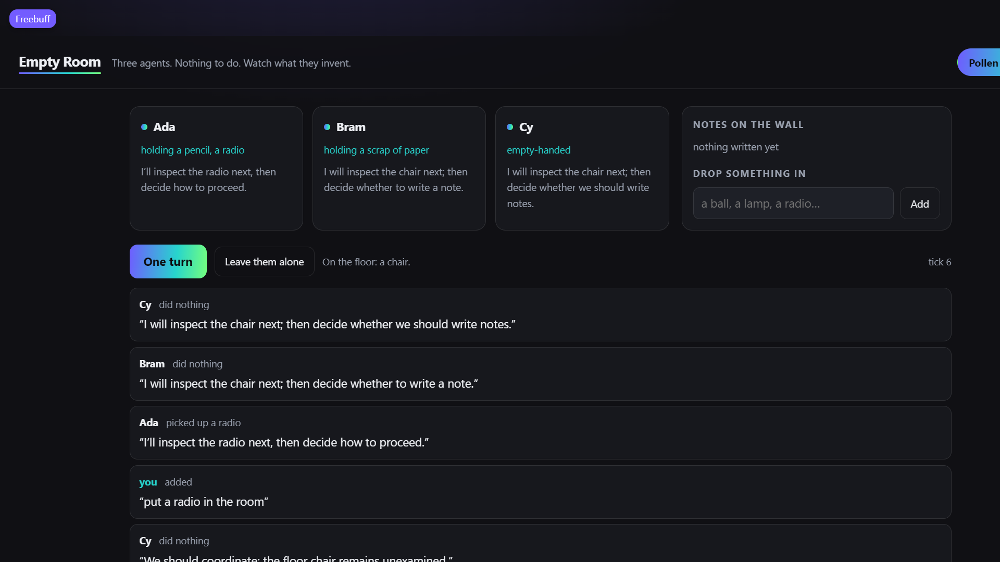

[](https://pollinations.ai/?ref=badge)

# Empty Room

Three agents, one plain room, no task. Watch what they do with the nothing, then drop an object in
and watch them absorb it. Live app: **https://rekty.github.io/empty-room/**



Built for [quest #19177](https://github.com/pollinations/pollinations/issues/19177), the quest about
agents left alone in a world with nothing they have to do.

## What happens

- The room starts with a chair, a scrap of paper and a pencil. Nobody owns them and nobody has been
  asked to do anything.
- Once per turn each agent gets the same plain state — who is present, what is on the floor, who
  holds what, the notes on the wall, the last six lines of speech — and answers with one action and
  one line of speech.
- **The page applies the action, not the model.** Picking up something already held, putting down
  nothing, or an invented verb is logged as refused, so the transcript always matches the actual
  room state.
- **Drop something in** (a radio, a ball, a lamp) and the same three agents have to make sense of it
  next turn. That is the only lever the human has: no instructions, no goals, just an object.
- **Leave them alone** runs a turn every nine seconds until you stop it.

Four allowed actions: `pick_up`, `put_down`, `write_note`, `nothing`. Notes land on the wall and are
part of the state from then on, which is how a room with nothing to do grows rules.

## Paying for it

One `openai/gpt-5.4-nano` completion per agent per turn, on the reader's own
[Pollen](https://github.com/pollinations/pollinations/blob/main/BRING_YOUR_OWN_POLLEN.md) (device
flow, token kept in the tab's `sessionStorage`, sent only to `gen.pollinations.ai`). An `sk_` key
can be pasted instead. Three calls a turn, each with a 400-token ceiling.

## Tests

```bash
node --test      # 10 tests
```

`shared/world.js` is pure and tested: the starting room, picking up and putting down (including the
refusal when an object is already held), notes, unknown verbs, tick accounting, adding an object,
`parseAction` against chatty model output, and a check that the observed state never contains words
like "goal", "reward" or "should" that would tell an agent what to want. The UI was exercised
against the live API with a real device-flow session.

## Run locally

```bash
python -m http.server 8091    # then open /empty-room/
```

Files: `index.html`, `style.css`, `app.js`, `shared/pollen.js` (device flow + one chat call),
`shared/world.js` (rules, state, prompt, parser), `test/world.test.mjs`.
